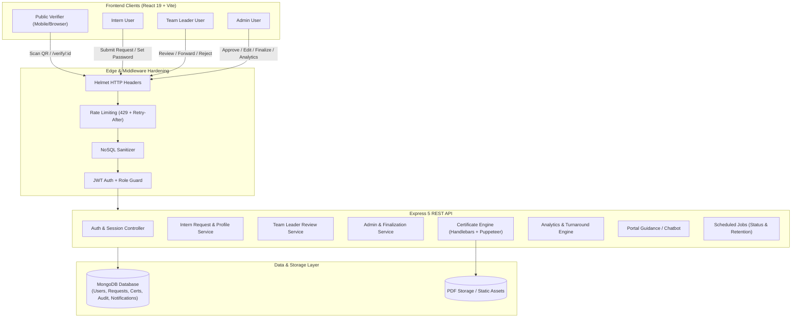
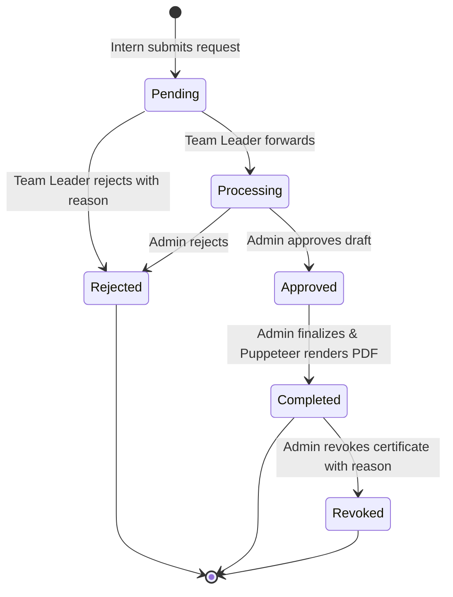

# UPTOSKILL Intern Portal — System Architecture

**Last Updated:** November 19, 2026  
**Document Version:** 4.1.0  

---

## 1. System Overview

The **UPTOSKILL Intern Portal** is an enterprise-grade web platform built to automate the end-to-end lifecycle of student internships: onboarding, certificate requests, team leader reviews, admin visual template editing, PDF generation, public verification via unguessable QR codes, automated data retention, notifications, and analytics.

The system is designed with a **unified user model**, strict role-based access control (RBAC), multi-tenant scoping, defensible audit trails, and resilient deployment hardening.

---

## 2. High-Level Flow Diagram

---

## 3. Core Architectural Modules

### 3.1 Single User Collection (Role-Based Access)
All system identities—`admin`, `teamleader`, and `intern`—are housed in a unified `User` collection.
- **Admin**: System configuration, user provisioning, template management, certificate finalization, retention policies, audit exports, and analytics.
- **Team Leader**: Manages assigned interns via `internshipDetails.teamLeaderId`, reviews certificate requests, forwards or rejects with reasons.
- **Intern**: Profile management, secure credential creation, certificate requests, request tracking, PDF downloads, and chatbot guidance.

### 3.2 Certificate Request & Approval Lifecycle

1. **Pending**: Submitted by intern. Auto-filled from intern profile. Visible to the intern's assigned Team Leader.
2. **Processing**: Reviewed and forwarded by the Team Leader. Escalated to Admin queue.
3. **Approved / Draft Generated**: Admin triggers draft generation using Handlebars templates.
4. **Completed / Finalized**: Admin approves the rendered layout; Puppeteer renders an A4 landscape PDF with QR code; PDF is saved and linked.
5. **Revoked**: Admin can revoke any issued certificate; public verification immediately reflects revocation details and date.

### 3.3 Certificate Generation Engine
- **Template Compilation**: Dynamic Handlebars templates populate recipient name, dates, domain, certificate number, verification ID, and QR code data URL.
- **Headless PDF Rendering with Auto-Discovery**: Puppeteer is managed via a singleton browser instance with `--no-sandbox` and `--disable-dev-shm-usage` flags. The engine incorporates an automatic browser discovery fallback (`findSystemChrome`):
  - Checks Puppeteer bundled cache (`~/.cache/puppeteer`).
  - Automatically resolves system-installed Chrome (`C:\Program Files\Google\Chrome\Application\chrome.exe` on Windows, Edge paths, or standard Linux/macOS paths).
  - Respects `PUPPETEER_EXECUTABLE_PATH` and `CHROME_PATH` environment variables.
  - Pages are rendered at A4 landscape with zero margins, awaiting `document.fonts.ready`, and closed safely in `finally` blocks.
- **Verification QR Codes**: High-contrast QR codes encode unguessable 12-character verification IDs (`/verify/:verifyId`).

### 3.4 Scheduled Background Jobs (Asia/Kolkata)
- **Internship Status Updates (Daily at 00:00 IST)**: Updates statuses (`upcoming` → `ongoing` → `completed`) according to current calendar date.
- **Data Retention & Archival (Daily at 02:00 IST)**:
  - Archives completed/cancelled interns after configurable threshold (default 90 days).
  - Sends warning notifications prior to archiving.
  - Purges or soft-deletes eligible accounts beyond purge window.
  - Supports non-destructive **dry-run** mode.

### 3.5 Real-Time Notifications & Audit Logging
- **Notification Service**: In-app notifications with unread counts and Brevo transactional SMTP email delivery.
- **Tamper-Evident Audit Logs**: All state transitions (`LOGIN`, `PASSWORD_CHANGED`, `REQUEST_SUBMITTED`, `REQUEST_FORWARDED`, `REQUEST_REJECTED`, `CERTIFICATE_FINALIZED`, `CERTIFICATE_REVOKED`, `USER_ARCHIVED`, `EXPORT`) are saved to an immutable `AuditLog` collection.

### 3.6 Frontend Architecture & Mobile-First Design System
- **Design Tokens**: Defined in `App.css` using official UptoSkills identity colors (Teal `#0D9488`, Vibrant Orange `#F26A34`, Cap Blue `#2563EB`).
- **Icon Architecture**: Zero raw emojis; 100% accessible inline SVGs from `Icons.jsx` with ARIA labels and `:focus-visible` compliance.
- **3-Tier Responsive Layout**:
  - Desktop (`> 1024px`): Fixed 2-column sidebar (`260px 1fr`) with auto-fitting quick action cards (`repeat(auto-fit, minmax(240px, 1fr))`).
  - Tablet (`<= 1024px`): Sticky, touch-scrollable horizontal navigation bar, multi-column metric/form cards collapsing to 2 columns.
  - Mobile Landscape (`<= 768px`): Topbar user details collapse to icon buttons; Intern dashboard switches to bottom navigation dock (`.id-mobile-nav`).
  - Mobile Portrait (`<= 480px` & `<= 380px`): Full-width stacked action cards, single-column forms, and floating chat bottom-sheet drawer (`height: 82vh`).

### 3.7 Dual AI Guidance Architecture
- **In-App Portal Assistant (`/api/intern/chat`)**: Contextual intern guidance for status tracking, certificate eligibility, and account settings.
- **Standalone Knowledge Base RAG Assistant (`Web_Support_Chatbot/`)**: Python FastAPI backend with FAISS vector index and document embeddings (`document.txt`) providing knowledge base retrieval for complex student queries.
