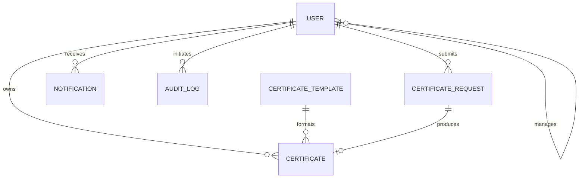

# UPTOSKILL Intern Portal — Data Model Specification

**Last Updated:** November 19, 2026  
**Document Version:** 4.1.0  
**Database Engine:** MongoDB 6.0+ / Mongoose  

---

## 1. Entity-Relationship Overview

---

## 2. Collections & Schema Details

### 2.1 `users`
Stores all account identities (`admin`, `teamleader`, `intern`).

| Field | Type | Description |
|---|---|---|
| `_id` | ObjectId | Primary Key |
| `fullName` | String | Full user name |
| `email` | String | Unique email (normalized lowercase, indexed) |
| `password` | String | Bcrypt hash (cost 10) |
| `internCode` | String | Unique code (e.g. `INT-4X9K2Q`, initial login secret for interns) |
| `mobileNo` | String | Phone number (whitelisted editable by intern) |
| `domain` | String | Internship domain (e.g. "Web Development") |
| `startDate` | Date | Start date of internship |
| `endDate` | Date | End date of internship |
| `role` | String | `admin` \| `teamleader` \| `intern` |
| `passwordSetAt` | Date | Timestamp when user configured custom password |
| `internshipDetails.teamLeaderId` | ObjectId | References assigned Team Leader (`users._id`) |
| `internshipDetails.teamleaderEmail`| String | Lowercase email of assigned Team Leader |
| `internshipDetails.status` | String | `upcoming` \| `ongoing` \| `completed` \| `cancelled` |
| `internshipDetails.createdBy` | ObjectId | References user who created this account |
| `isArchived` | Boolean | True when archived by retention job |
| `archivedAt` | Date | Archival timestamp |
| `isPurged` | Boolean | True when soft-purged |

**Indexes:**
- `{ email: 1 }` (unique)
- `{ internCode: 1 }` (unique, sparse)
- `{ role: 1, isArchived: 1 }`
- `{ role: 1, domain: 1 }`
- `{ 'internshipDetails.teamLeaderId': 1, role: 1 }`
- `{ 'internshipDetails.teamleaderEmail': 1, role: 1 }`
- `{ 'internshipDetails.status': 1, isArchived: 1 }`

---

### 2.2 `certificate_requests`
Tracks student requests for certificates through review and finalization.

| Field | Type | Description |
|---|---|---|
| `_id` | ObjectId | Primary Key |
| `requestNumber` | String | Unique human-readable ID (e.g. `CERT-2026-00042`) |
| `userId` | ObjectId | References `users._id` (intern) |
| `internCode` | String | Intern code snapshot |
| `certificateType`| String | Type identifier (`completion_certificate`, `bonafide`, etc.) |
| `templateId` | ObjectId | References `certificate_templates._id` |
| `reason` | String | Intern's reason for request |
| `status` | String | `pending` \| `processing` \| `approved` \| `completed` \| `rejected` \| `cancelled` |
| `requestedAt` | Date | Creation timestamp |
| `forwardedBy` | ObjectId | References Team Leader who forwarded the request |
| `forwardedAt` | Date | Timestamp forwarded by Team Leader |
| `reviewedBy` | ObjectId | References reviewer (TL or Admin) |
| `reviewedAt` | Date | Timestamp reviewed |
| `rejectionReason`| String | Rejection reason when rejected |
| `certificateId` | ObjectId | References produced `certificates._id` |

**Status Lifecycle Meanings:**
- `pending`: Submitted by intern; waiting for assigned Team Leader review.
- `processing`: Forwarded by Team Leader; waiting in Admin queue.
- `approved`: Admin generated draft certificate; waiting visual review and finalization.
- `completed`: Admin finalized certificate; PDF rendered and ready for download.
- `rejected`: Terminal state; rejected by Team Leader or Admin with recorded reason.

**Indexes:**
- `{ requestNumber: 1 }` (unique)
- `{ userId: 1 }`
- `{ status: 1 }`
- `{ requestedAt: -1, status: 1 }`
- `{ reviewedBy: 1, reviewedAt: -1 }`

---

### 2.3 `certificates`
Stores metadata and rendered layouts for generated and finalized certificates.

| Field | Type | Description |
|---|---|---|
| `_id` | ObjectId | Primary Key |
| `certificateNumber` | String | Unique certificate identifier |
| `userId` | ObjectId | References `users._id` |
| `internCode` | String | Intern code snapshot |
| `templateId` | ObjectId | References `certificate_templates._id` |
| `certificateType`| String | Certificate type string |
| `domain` | String | Domain snapshot |
| `issuedDate` | Date | Official issue date |
| `status` | String | `draft` \| `finalized` \| `revoked` |
| `htmlContent` | String | Rendered HTML with filled Handlebars variables |
| `pdfPath` | String | Relative server storage path to generated PDF |
| `verificationCode`| String | Verification code |
| `verifyId` | String | Unguessable 12-char verification ID for QR link |
| `isRevoked` | Boolean | True if revoked by Admin |
| `revokedAt` | Date | Revocation timestamp |
| `revokedBy` | ObjectId | References Admin who revoked |
| `revokedReason`| String | Stated reason for revocation |

**Indexes:**
- `{ certificateNumber: 1 }` (unique)
- `{ verifyId: 1 }` (unique)
- `{ verificationCode: 1 }` (unique)
- `{ userId: 1 }`
- `{ status: 1 }`
- `{ issuedDate: -1, status: 1 }`
- `{ certificateType: 1, domain: 1 }`

---

### 2.4 `audit_logs`
Tamper-evident, immutable activity journal.

| Field | Type | Description |
|---|---|---|
| `_id` | ObjectId | Primary Key |
| `actorId` | ObjectId | User initiating the action (`null` for system/anonymous) |
| `actorRole` | String | `admin` \| `teamleader` \| `intern` \| `system` |
| `action` | String | Enum action name (`LOGIN`, `REQUEST_FORWARDED`, `EXPORT`, etc.) |
| `targetType` | String | Target model name (`user`, `certificate_request`, etc.) |
| `targetId` | Mixed | Identifier of target document |
| `meta` | Mixed | Sanitized action-specific details (no passwords/tokens) |
| `ip` | String | Client IP address |
| `userAgent` | String | Client user-agent string |
| `createdAt` | Date | Immutable timestamp (indexed descending) |

*Immutability:* Schema hooks reject `updateOne`, `findOneAndUpdate`, and `deleteOne` operations.

---

### 2.5 `notifications`
In-app notifications for interns and mentors.

| Field | Type | Description |
|---|---|---|
| `_id` | ObjectId | Primary Key |
| `userId` | ObjectId | Recipient `users._id` (indexed) |
| `title` | String | Notification headline |
| `message` | String | Notification body |
| `type` | String | Notification type enum |
| `isRead` | Boolean | Read state (indexed) |
| `readAt` | Date | Timestamp marked as read |
| `createdAt` | Date | Notification timestamp |
